# Architecture Guide — J.A.R.V.I.S. for Wear OS (`V6`)

This document describes the actual source-code architecture of **J.A.R.V.I.S. for Wear OS** (`com.jarvis.wear`, baseline V6).

---

## 1. High-Level System Diagram

```mermaid
graph TD
    subgraph "Presentation & Circular UI Layer (Jetpack Compose for Wear OS)"
        MA["MainActivity : WearableActivity<br/>(AmbientLifecycleObserver + RotaryBezelDispatcher)"]
        NH["JarvisWearNavHost<br/>(SwipeDismissableNavHost + Screen Torch Overlay)"]
        HS["HomeScreen<br/>(ArcReactorCanvas + Telemetry + Optional 2-Line Captions)"]
        DS["DialogueScreen<br/>(ScalingLazyColumn + Confirmation Card + Input Bar)"]
        SM["SystemMatrixScreen<br/>(6-Node Polar Hub: AI LINK, REACTOR, VOICE, PERSONA, MEMORY, ABOUT)"]
        CRS["CircularResponsiveSpec<br/>(Runtime Chord & Polar Geometry for 320x320–480x480)"]
    end

    subgraph "State & Domain Orchestration"
        VM["JarvisViewModel : AndroidViewModel"]
        HRIP["HomeReactorInteractionPolicy<br/>(Stays on Home Screen + Caption Visibility)"]
        ISR["InputSubmissionRouter<br/>(Separates Typed Input from Microphone)"]
        PE["PersonalityEngine"]
        ASE["AdaptiveSuggestionEngine"]
    end

    subgraph "AI & Voice Subsystem"
        AIR["AiRepository & AiPayloadCodec"]
        GP["GeminiProvider<br/>(REST + /v1beta/models Discovery)"]
        OAP["OpenAiProvider<br/>(Chat + Reasoning o1/o3/o4/gpt-5)"]
        CP["CustomOpenAiCompatibleProvider<br/>(OpenRouter / Groq / Self-Hosted)"]
        SRM["SpeechRecognitionManager<br/>(Android SpeechRecognizer + Session Token Guard)"]
        TTS["TextToSpeechManager & JarvisVoiceSelector<br/>(Google/Samsung TTS UK Male Scoring + OpenAI Onyx Cloud TTS)"]
    end

    subgraph "Wear OS Hardware & Persistence Layer"
        DCM["DeviceControlManager & VoiceActionParser<br/>(Battery, Status, Timers, Alarms, Torch, DND, BT/Wi-Fi Handoffs)"]
        HM["JarvisHapticManager & HapticEventPolicy<br/>(Predefined Effects + 38ms Rotary Tick Rate Limiter)"]
        NM["NetworkMonitor<br/>(ConnectivityManager CallbackFlow)"]
        CV["CredentialVault<br/>(EncryptedSharedPreferences AES256-GCM + Fallback)"]
        SR["SettingsRepository<br/>(SharedPreferences Per-Provider State)"]
        CDB["ConversationDatabase (Room SQLite)<br/>(MessageDao + ConversationMemoryHelper)"]
    end

    MA --> NH
    NH --> HS
    NH --> DS
    NH --> SM
    HS -.-> CRS
    DS -.-> CRS
    SM -.-> CRS

    NH --> VM
    VM --> HRIP
    VM --> ISR
    VM --> PE
    VM --> ASE
    VM --> AIR
    AIR --> GP
    AIR --> OAP
    AIR --> CP
    VM --> SRM
    VM --> TTS
    VM --> DCM
    VM --> HM
    VM --> NM
    VM --> CV
    VM --> SR
    VM --> CDB
```

---

## 2. Package & Module Structure

The Android application resides in `:app` (`jarvis-wearos-android/app/src/main/java/com/jarvis/wear/`):

| Package / File | Responsibility |
| :--- | :--- |
| `com.jarvis.wear.MainActivity` | `WearableActivity` base class capturing `InputDevice.SOURCE_ROTARY_ENCODER` events via `RotaryBezelDispatcher`, and `MainActivity` binding `AmbientLifecycleObserver` and runtime `RECORD_AUDIO` permissions. |
| `com.jarvis.wear.navigation.JarvisWearNavHost` | Configures Wear OS `SwipeDismissableNavHost` with three destinations (`"home"`, `"dialogue"`, `"system_matrix"`) plus the full-luminance AMOLED Screen Torch overlay. |
| `com.jarvis.wear.presentation.JarvisViewModel` | Single source of truth for UI state (`StateFlow`), coordinating voice capture, typed commands, AI requests, TTS playback, device actions, and settings persistence. |
| `com.jarvis.wear.ui.components.CircularHudComponents` | Houses `CircularResponsiveSpec` (computing safe chords and polar radii across 9 round screen profiles), `RememberCircularSpec()`, `CircularHeaderBar`, `CircularIconButton`, and `PerimeterTickRing`. |
| `com.jarvis.wear.ui.reactor.ArcReactorCanvas` | 60fps Jetpack Compose `Canvas` rendering 4 selectable reactor themes (`MARK_I`, `MARK_II`, `MARK_III`, `NANO`), 6 operational states (`IDLE`, `LISTENING`, `PROCESSING`, `SPEAKING`, `DISCONNECTED`, `ERROR`), and low-power wireframe Ambient Mode (`drawAmbientReactor`). |
| `com.jarvis.wear.ui.home.HomeScreen` | Circular Home screen featuring top time/battery/greeting telemetry, central interactive Arc Reactor, reserved `28dp` 2-line response caption slot, and bottom orbital dock (`Dialogue`, `Reactor/Stop`, `Matrix`). |
| `com.jarvis.wear.ui.dialogue.DialogueScreen` | Scrollable conversation history (`ScalingLazyColumn`), destructive clear confirmation, pending device-action confirmation card, audio replay/stop controls, and compact bottom text/voice input dock. |
| `com.jarvis.wear.ui.settings.SystemMatrixScreen` | 6-node circular polar hub (`AI LINK`, `REACTOR`, `VOICE`, `PERSONA`, `MEMORY`, `ABOUT`) around a central `CORE` indicator, plus dedicated sub-screens. |
| `com.jarvis.wear.ai.AiProvider` | Defines `AiProvider`, `AiPayloadCodec` (pure validation, payload formatting, and response/discovery parsing), `GeminiProvider`, `OpenAiProvider`, `CustomOpenAiCompatibleProvider`, and `AiRepository`. |
| `com.jarvis.wear.ai.PersonalityEngine` | Builds watch-optimized system prompts (`stark_classic`, `tactical_hud`, `formal_butler`) and time-of-day greetings. |
| `com.jarvis.wear.voice.SpeechRecognitionManager` | Wraps `android.speech.SpeechRecognizer` with monotonically increasing `activeSessionId` tokens so cancelled sessions cannot emit stale error callbacks. |
| `com.jarvis.wear.voice.TextToSpeechManager` | Wraps `android.speech.tts.TextToSpeech` (preferring `com.google.android.tts` with fallback to system TTS), scores British English Male voices via `JarvisVoiceSelector`, applies pitch compensation (`0.84f–0.90f`) if only female/neutral voices exist, and supports optional OpenAI `onyx` Cloud TTS. |
| `com.jarvis.wear.device.DeviceControlManager` | Contains `VoiceActionParser` (deterministic command parser) and `DeviceControlManager` (executes battery/status readouts, timers, alarms, flashlight/torch, DND with confirmation, app launching, and Bluetooth/Wi-Fi settings handoffs). |
| `com.jarvis.wear.data.security.CredentialVault` | Stores per-provider API keys and custom Base URLs in `EncryptedSharedPreferences` (`AES256_GCM`) with corruption recovery and key masking. |
| `com.jarvis.wear.data.preferences.SettingsRepository` | Persists `JarvisSettingsState` in `SharedPreferences` (`jarvis_wear_settings`), preserving per-provider models (`geminiModel`, `openaiModel`, `customModel`) across provider switches. |
| `com.jarvis.wear.data.database.ConversationDatabase` | Room SQLite database (`jarvis_wear_dialogue.db`) storing `MessageEntity` rows and building bounded context windows via `ConversationMemoryHelper`. |
| `com.jarvis.wear.services.JarvisHapticManager` | Triggers predefined `VibrationEffect` primitives governed by `HapticEventPolicy` (`38ms` minimum interval between rotary bezel ticks). |
| `com.jarvis.wear.services.NetworkMonitor` | Exposes `isOnline: Flow<Boolean>` via `ConnectivityManager.NetworkCallback` to drive automatic `DISCONNECTED` state transitions. |
| `com.jarvis.wear.suggestions.AdaptiveSuggestionEngine` | Computes up to 2 local quick-command suggestions based on recent prompt keywords without external telemetry. |

---

## 3. Key Interaction Flows

### 3.1 Home-Screen Voice Interaction Flow (`V5`/`V6`)
1. User taps the central Arc Reactor on `HomeScreen`.
2. `HomeScreen` invokes `viewModel.toggleVoiceInteraction(onPermissionRequired, onNavigateToDialogue = null)`.
3. If `RECORD_AUDIO` permission is granted:
   - Operational state transitions `IDLE → LISTENING`.
   - `activeHomeCaption` is hidden while `LISTENING` and `PROCESSING` (`HomeReactorInteractionPolicy.resolveVisibleHomeCaption`).
   - `SpeechRecognitionManager.startListening(...)` streams partial transcripts to the top status banner.
4. When final speech is recognized:
   - State transitions `LISTENING → PROCESSING`.
   - `VoiceActionParser.parse(prompt)` checks if the command is a local device action (e.g., `"What is my battery level?"`, `"Set a timer for 5 minutes"`).
   - If handled locally by `DeviceControlManager`, the response is recorded in Room, displayed in the Home screen's reserved 2-line caption slot (if `homeCaptionsEnabled`), and spoken via `TextToSpeechManager` (`PROCESSING → SPEAKING → IDLE`).
   - Otherwise, `AiRepository.getProvider(providerId).sendMessage(...)` dispatches the prompt and recent context window on `Dispatchers.IO`, stores the assistant response in Room, sets `activeHomeCaption`, and speaks the reply (`SPEAKING → IDLE`) while remaining on `HomeScreen`.

### 3.2 Typed Message Submission Flow (`InputSubmissionRouter`)
1. User opens `DialogueScreen` and types a message in the bottom text field.
2. Submitting the text calls `viewModel.submitTypedMessage(query)`.
3. `InputSubmissionRouter.routeTypedMessage(rawText, currentState)` normalizes the prompt, sets `shouldStartMicrophone = false`, cancels any active microphone session (`speechRecognizer.stopListening()` incrementing `activeSessionId`), and transitions directly to `OperationalState.PROCESSING`.
4. The typed message is dispatched to `sendUserCommand(...)` without ever invoking `SpeechRecognizer`.

### 3.3 Circular Responsive Geometry (`CircularResponsiveSpec`)
On circular displays, top and bottom rows have narrower horizontal width than the equator (`R`). `CircularResponsiveSpec.fromDiameterDp(...)` calculates the exact circular chord at vertical offset ratio `yOffsetRatio`:
$$\text{chordWidth} = 2 \cdot R \cdot \sqrt{1 - y_{\text{ratio}}^2}$$
- **Header Safe Width**: Chord at `yOffsetRatio = 0.56f` minus `8dp`, preventing top Back buttons and centered titles from clipping against the upper bezel arc.
- **Bottom Dock Safe Width**: Chord at `yOffsetRatio = 0.62f` minus `8dp`, ensuring bottom orbital dock buttons (`Dialogue`, `Reactor`, `Matrix`) sit inside the lower bezel arc.
- **System Matrix Polar Hub**: Places the 6 category nodes at radius `matrixRingRadiusDp = diameter * 0.305f` at angles `-90°`, `-30°`, `30°`, `90°`, `150°`, and `210°` around the center `CORE` badge, enabling vertical scroll fallback automatically when `diameterDp < 182f` (`320×320`, `360×360`) or `fontScale > 1.15f`.

---

## 4. Threading & Coroutine Model

- **UI & SpeechRecognizer**: Android requires `SpeechRecognizer` and `TextToSpeech` initialization on `Dispatchers.Main` (`viewModelScope` default).
- **Networking (`AiProvider`, Cloud TTS)**: All OkHttp calls execute inside `withContext(Dispatchers.IO)` with explicit connect (`15s`), read (`25s`), and write (`15s`) timeouts. Coroutine cancellation (`CancellationException`) is explicitly rethrown in `runCatching` blocks.
- **Database (`ConversationDatabase`)**: Room `suspend` DAO methods (`insertMessage`, `getRecentMessages`, `clearAllMessages`) and `Flow<List<MessageEntity>>` execute off the main thread via `room-ktx`.

---

## 5. Known Architectural Debt & Future Improvements

1. **Manual Dependency Injection in `JarvisViewModel`**:
   - `JarvisViewModel` currently instantiates `SettingsRepository`, `CredentialVault`, `ConversationDatabase`, `SpeechRecognitionManager`, `TextToSpeechManager`, `DeviceControlManager`, `JarvisHapticManager`, and `NetworkMonitor` directly in its constructor using `application.applicationContext`. While pure policies and codecs (`AiPayloadCodec`, `VoiceActionParser`, `JarvisVoiceSelector`, `CircularResponsiveSpec`, `InputSubmissionRouter`) are extracted as standalone objects for unit testing, introducing constructor-injected interfaces or Hilt/Koin would enable full end-to-end `JarvisViewModel` coroutine unit testing without Android framework mocks.
2. **Non-Streaming Native AI Responses**:
   - The native Wear OS `AiProvider` implementations (`GeminiProvider`, `OpenAiProvider`, `CustomOpenAiCompatibleProvider`) currently perform standard synchronous JSON request/response calls over `Dispatchers.IO` rather than Server-Sent Events (SSE) token streaming, because `TextToSpeechManager` speaks complete utterances and the 40mm watch screen prioritizes complete 1–3 sentence responses.
3. **Unencrypted Room SQLite Database**:
   - API keys are encrypted via `EncryptedSharedPreferences` (`AES256_GCM`), and `android:allowBackup="false"` is enforced, but the local Room database (`jarvis_wear_dialogue.db`) uses standard SQLite inside the private app sandbox rather than SQLCipher.
